<div align="center">


# KAVO: Mobile App

**Coffee Brings Energy.** The Flutter app for KAVO, a coffee and food cafe in Faisalabad. Customers browse the live menu, build a tray, place orders, track them and book tables. Menu, prices, theme and business info all come from the [admin panel](https://kavo-admin.sytal.io), so the cafe updates the app without releasing a new version.

**📱 Android APK:** [Download from Releases](https://github.com/sytal/kavo-app/releases/latest) · **🌐 Website:** [kavo.sytal.io](https://kavo.sytal.io) · **⚙️ Backend:** [sytal-coffee](https://github.com/sytal/sytal-coffee)


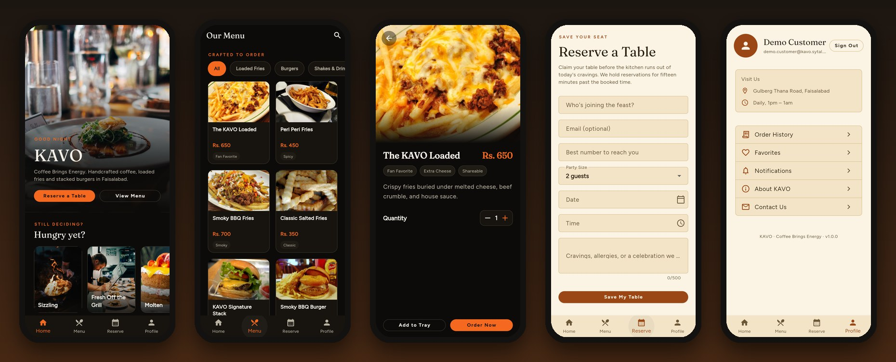

</div>

## Try the demo

| Email | Password |
|---|---|
| `demo.customer@kavo.sytal.io` | `DemoCustomer#2026` |

This account already has a few orders, so *Order History* has something to show. The same login works on [kavo.sytal.io](https://kavo.sytal.io).

## Features

- **Branded splash.** The KAVO logo (a coffee cup with an energy bolt) and the *Coffee Brings Energy* tagline.
- **Live menu.** Category filters, search, dish tags and a detail page for every dish. Data comes from the API with images served by the backend.
- **Tray and checkout.** Add dishes with quantities, change them in the tray and place a cash-on-delivery order. Prices are always recalculated on the server.
- **Order history.** Every past order with its items, address, total and a live status (Pending, Preparing, Out for Delivery, Completed).
- **Table reservations.** Party size, date and time slots based on the cafe's real opening hours, with form validation.
- **Accounts.** Register, sign in and sign out with Laravel Sanctum tokens. The session is kept on the device with `shared_preferences`.
- **Remote theming.** The app uses the colour theme and light/dark mode chosen in *Admin > Appearance* on the next launch.
- **Business info from the admin panel.** Phone, address, opening hours and social links come from *Admin > Business Info*.
- **About and contact screens.** One-tap call, WhatsApp and email links that open with `url_launcher`.

## Screenshots

**Light theme**

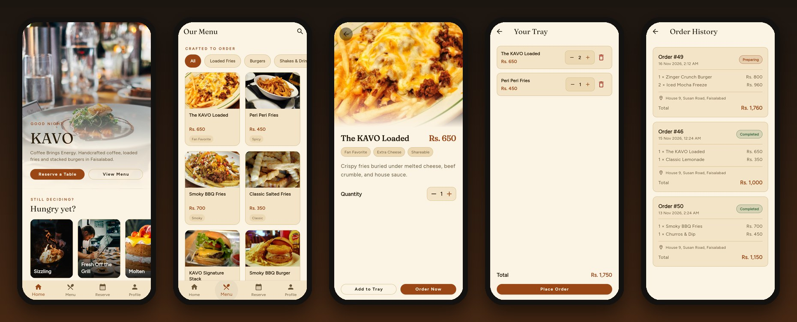

<p align="center">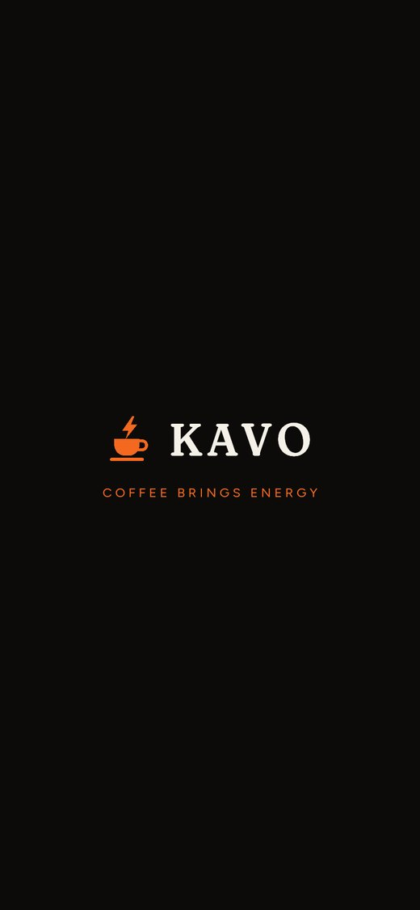<br><sub>Splash screen</sub></p>

<table>
  <tr>
    <td>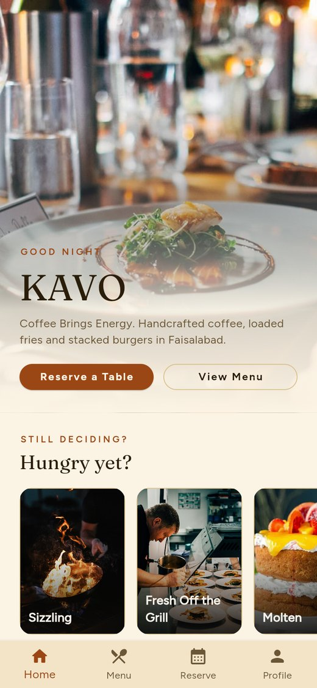</td>
    <td>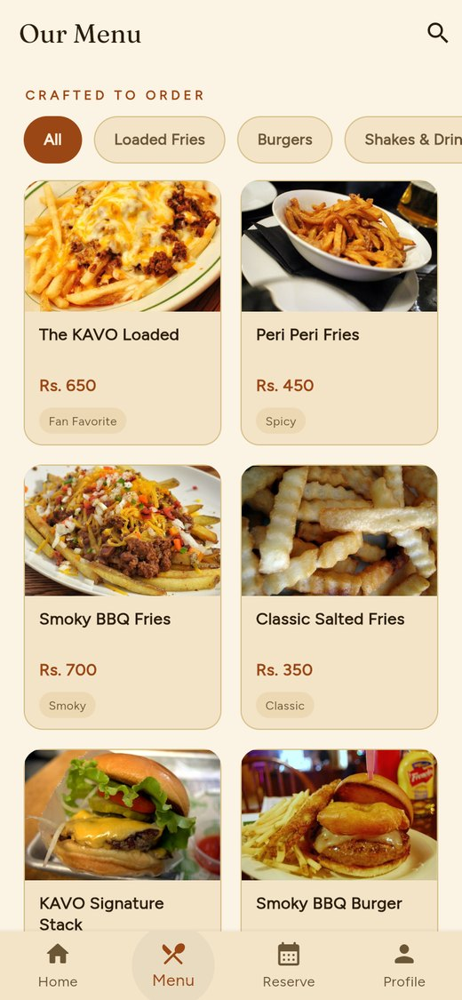</td>
    <td>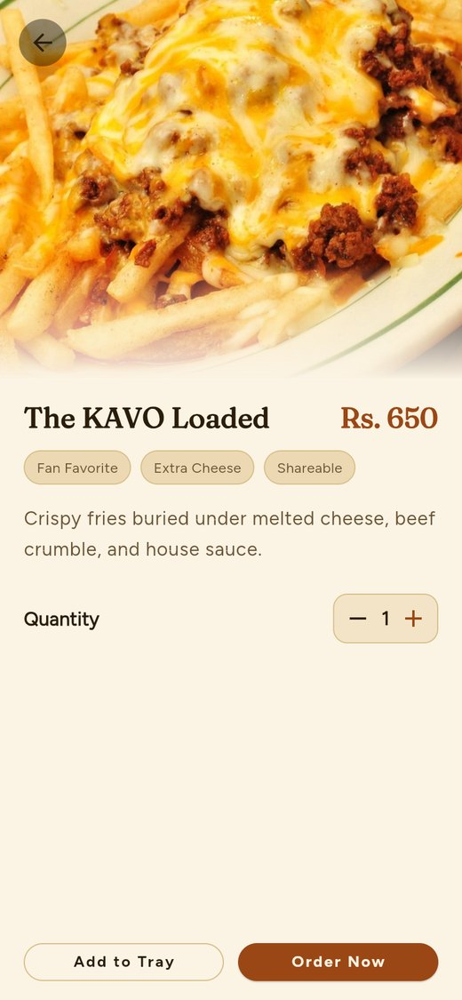</td>
    <td>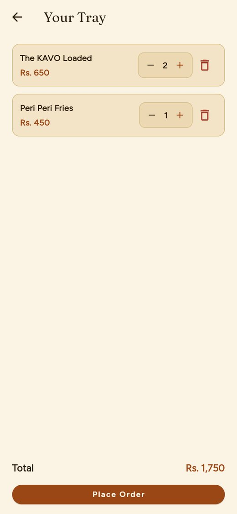</td>
  </tr>
  <tr>
    <td align="center"><sub>Home</sub></td>
    <td align="center"><sub>Menu</sub></td>
    <td align="center"><sub>Dish detail</sub></td>
    <td align="center"><sub>Tray</sub></td>
  </tr>
  <tr>
    <td>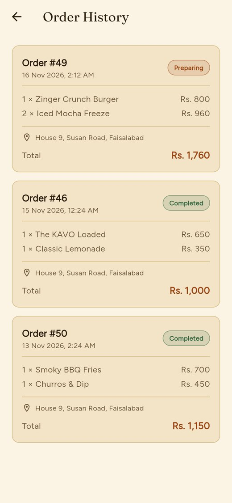</td>
    <td>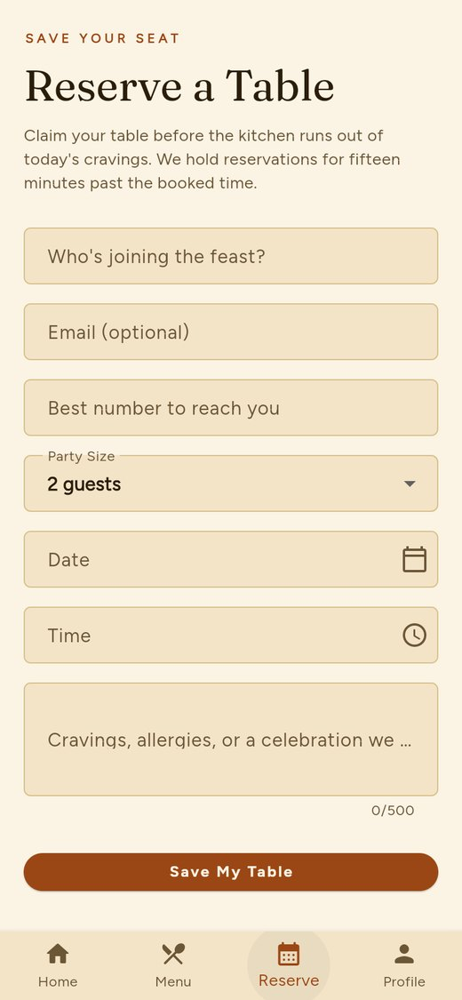</td>
    <td>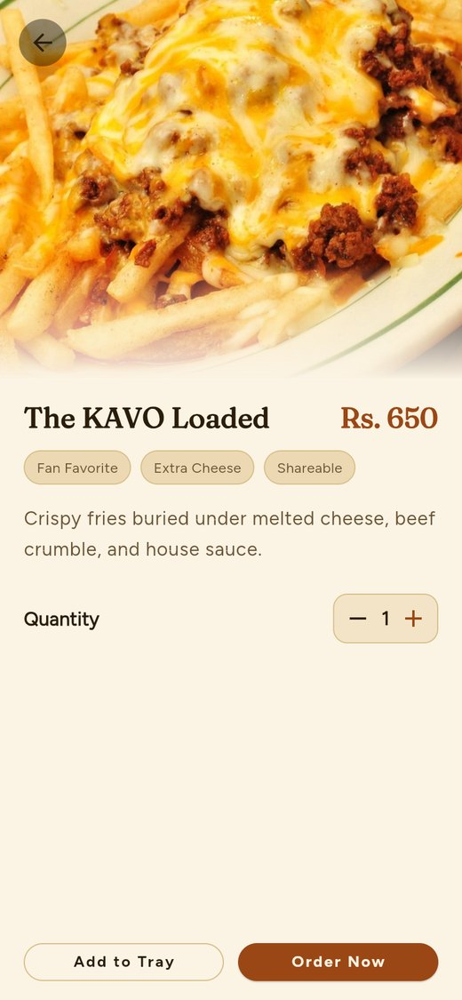</td>
    <td>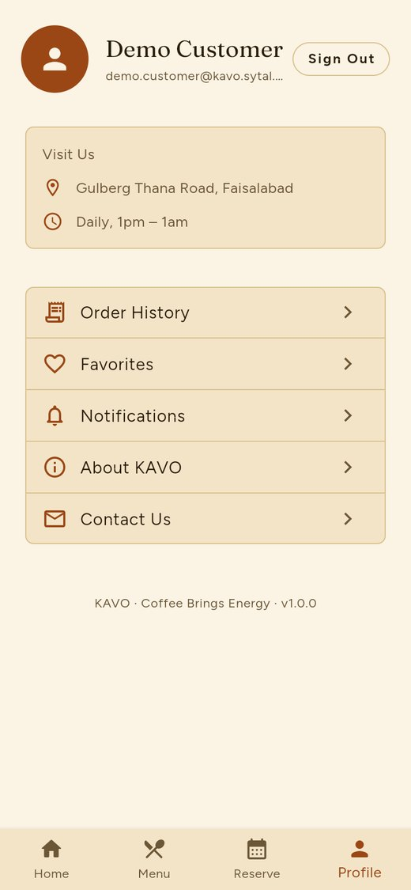</td>
  </tr>
  <tr>
    <td align="center"><sub>Order history</sub></td>
    <td align="center"><sub>Reserve a table</sub></td>
    <td align="center"><sub>Sign in</sub></td>
    <td align="center"><sub>Profile</sub></td>
  </tr>
</table>

**Managed from the admin panel.** Orders placed in the app appear on the admin dashboard within seconds, with a notification chime.

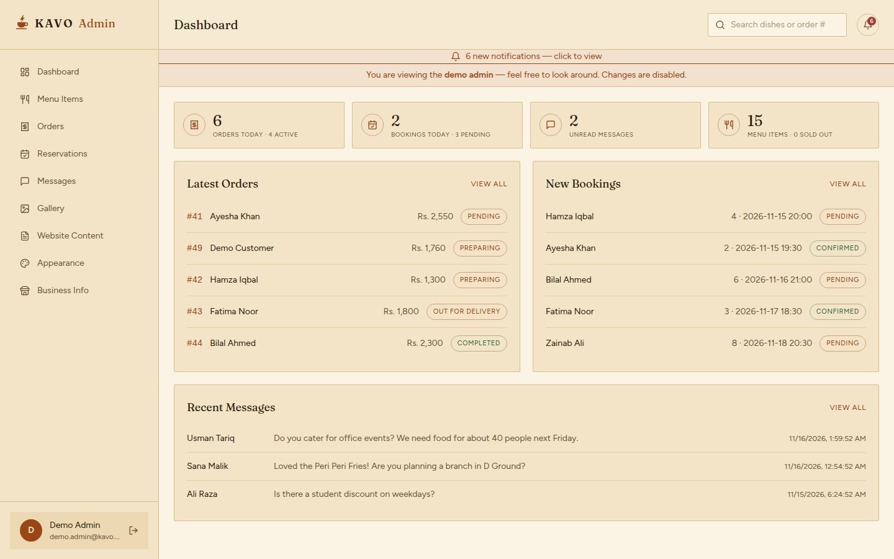

## Tech stack

| | |
|---|---|
| Framework | Flutter 3 / Dart 3 (Material 3) |
| Networking | `http` with a small `ApiClient` wrapper and bearer tokens |
| State | `ChangeNotifier` services (cart, auth) with `ListenableBuilder` |
| Storage | `shared_preferences` for the auth token |
| UI | `google_fonts` and a custom theme driven by the backend |
| Backend | Laravel 13 REST API at `/api/v1` ([sytal-coffee](https://github.com/sytal/sytal-coffee)) |

## Project structure

```
lib/
  main.dart            App entry, theme bootstrap
  screens/             home, menu, dish_detail, orders (tray, checkout, history),
                       reservations, profile, auth, info (about, contact)
  services/            api_client, auth, cart, menu, order, reservation,
                       business and theme_loader
  models/              AppUser, Order
  theme/               AppColors (updated from the API), AppTheme
  widgets/             Shared UI pieces
  utils/               Formatting, validators, link helpers
```

## Getting started

**Requirements:** Flutter 3.x and a running copy of the [backend](https://github.com/sytal/sytal-coffee).

```bash
git clone https://github.com/sytal/kavo-app.git
cd kavo-app
flutter pub get
```

Point the app at the backend with `API_BASE_URL`. Release builds use `https://kavo.sytal.io/api/v1`:

```bash
# Run on a device or emulator
flutter run --dart-define=API_BASE_URL=https://kavo.sytal.io/api/v1

# Android release APK
flutter build apk --release --dart-define=API_BASE_URL=https://kavo.sytal.io/api/v1

# Web build
flutter build web --release --dart-define=API_BASE_URL=https://kavo.sytal.io/api/v1
```

Without `API_BASE_URL`, the web build calls port `8011` on the host it was opened from. Mobile builds fall back to a local development address. On an Android emulator, use `http://10.0.2.2:8011/api/v1`.

## Running tests

```bash
flutter test
```
